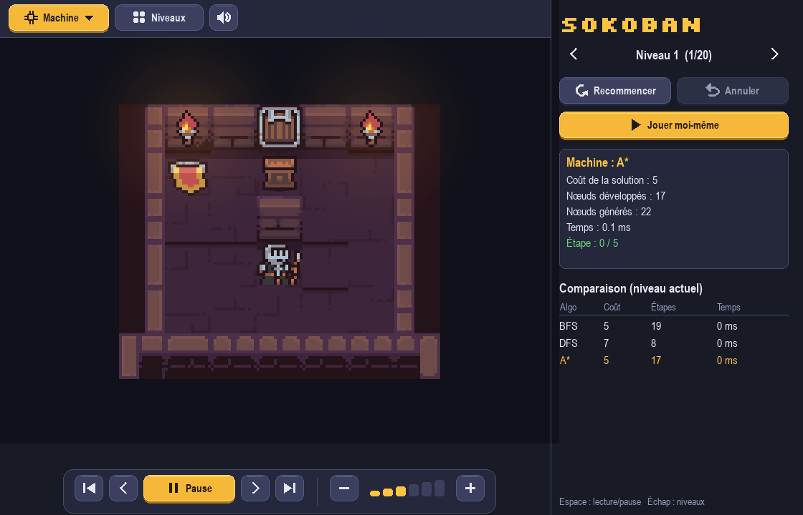
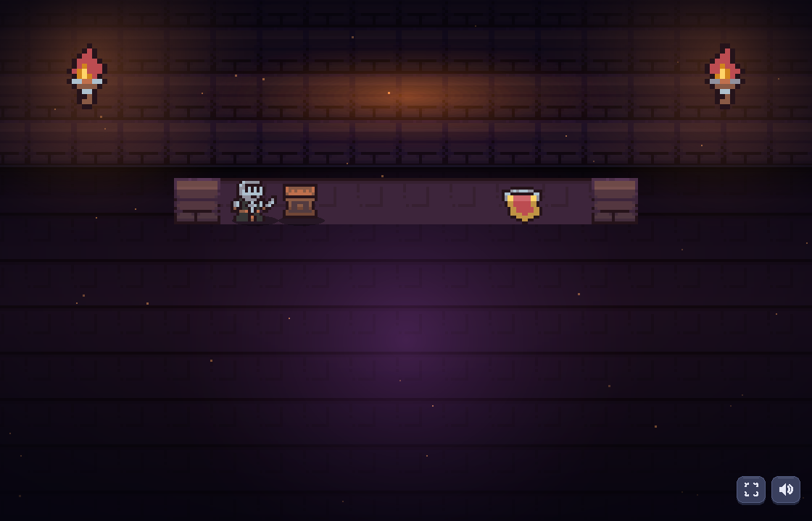
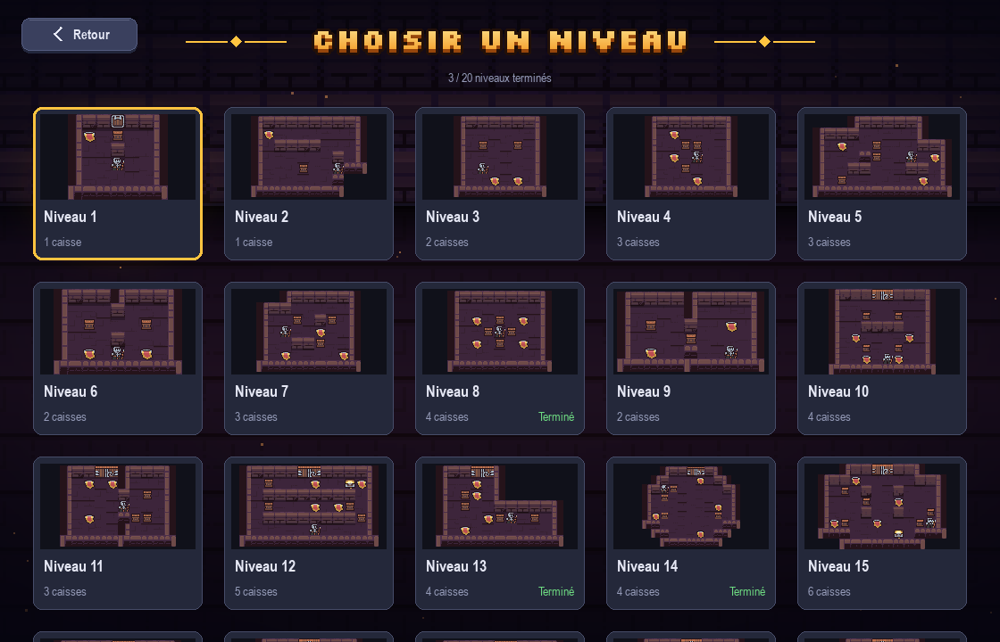
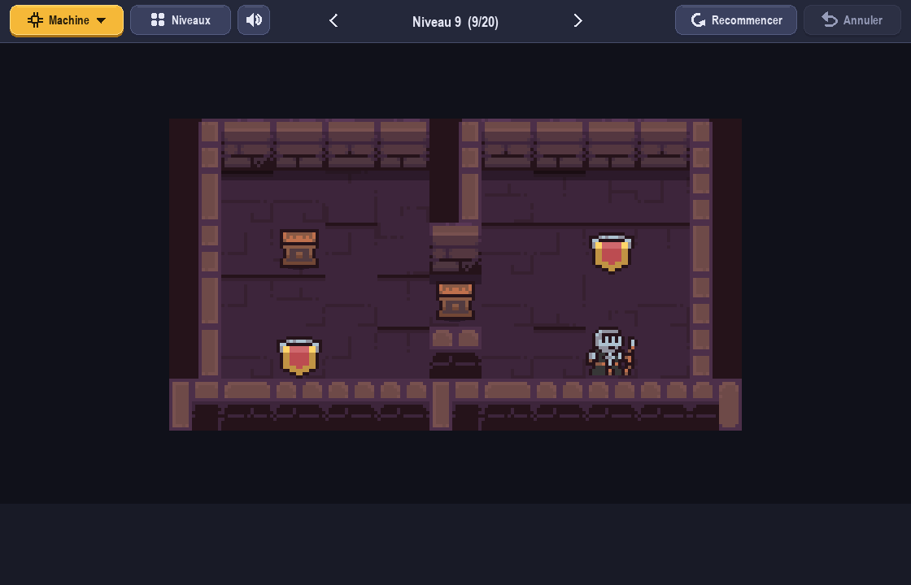
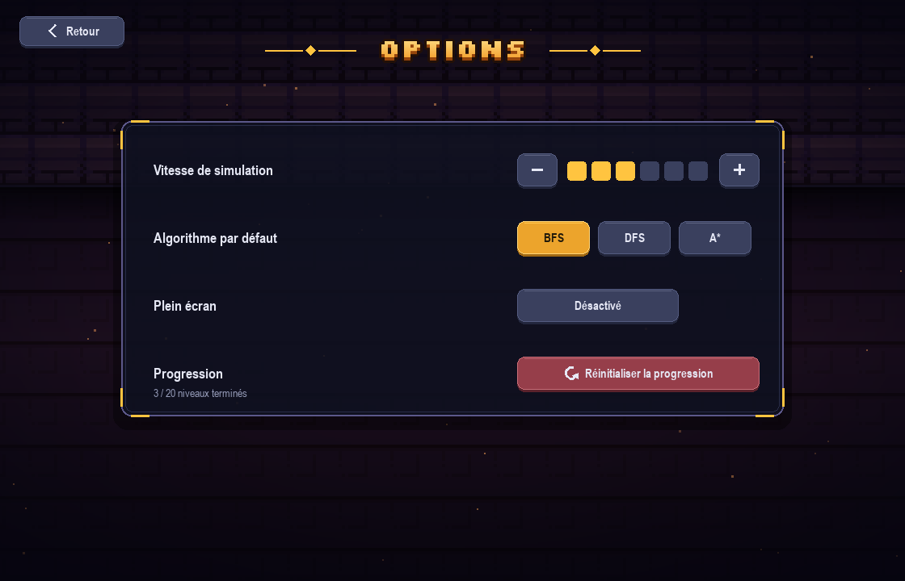
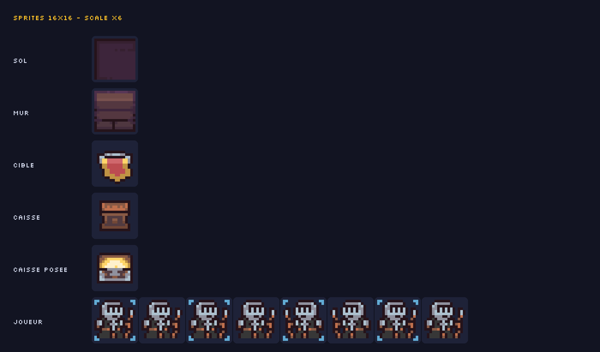
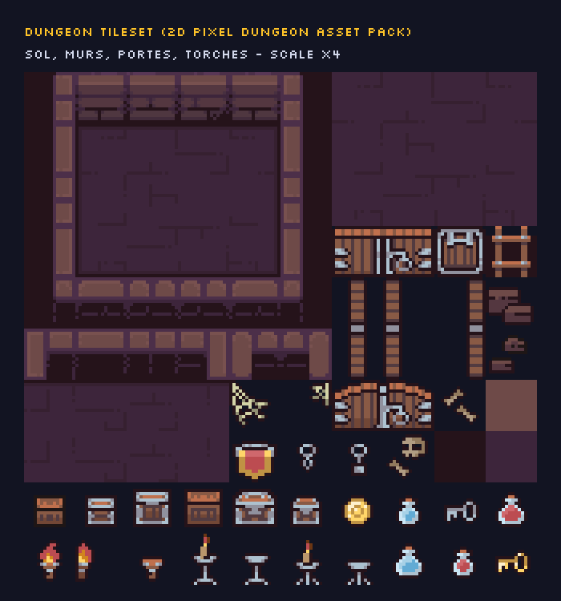

<div align="center">

# 🎮 SOKOBAN

### Modélisation & résolution automatique par recherche de solutions


**Jeu pixel-art jouable à la main + moteur de recherche qui résout les niveaux tout seul
(BFS, DFS, A\*) et les compare côte à côte.**



</div>

---

## ✨ Fonctionnalités

- 🕹️ **Jeu complet** — déplacement fluide (animations, 2 frames de marche par direction),
  annulation, redémarrage, déplacement continu en maintenant une touche.
- 🤖 **Mode Machine** — lancez BFS, DFS ou A\* sur le niveau courant et **regardez la solution
  se rejouer** pas à pas (lecture / pause / pas à pas / vitesse variable).
- 📊 **Tableau comparatif intégré** — coût, nœuds développés, nœuds générés et temps
  de mesure des 3 algorithmes, sur le même niveau.
- 🗺️ **20 niveaux** — du tutoriel (1 caisse) aux cas difficiles où A\* déploie ~65 000 nœuds
  et où BFS en développe ~800 000.
- 🧩 **Éditeur de niveaux en texte** — un niveau = un fichier `.txt` dessiné avec des caractères,
  validé et testé en un `python tools/check_levels.py`.
- 🎨 **Pixel art dungeon** — tileset *2D Pixel Dungeon Asset Pack*, torches animées, portes,
  murs et sol à variantes aléatoires, particules et parallaxe.
- 🔊 **Sons & musique** — 8 effets (pas, poussée, mur, cible, annulation, clic, victoire) + musique,
  tous remplaçables par vos fichiers.
- 💾 **Options sauvegardées** — vitesse, algorithme par défaut, plein écran, son, progression
  (`settings.json`).
- 🧠 **Architecture « vraie IA »** — modélisation du problème découplée des algorithmes :
  on ajoute un algorithme en **une ligne**.

---

## 🚀 Démarrage rapide

```bash
git clone https://github.com/trrayane/Sokoban.git
cd Sokoban

pip install -r requirements.txt   # pygame>=2.5
python main.py                    # écran d'accueil
```

Modes avancés :

```bash
python main.py --level 5                          # lance directement le niveau 5
python main.py --cli --level 10 --algo "A*"       # résolution en console, sans fenêtre
python tools/check_levels.py                      # valide & teste tous vos niveaux
python tools/generate_assets.py                   # régénère les sprites par défaut
python tools/generate_sounds.py                   # régénère les sons par défaut
```

> **Première exécution :** si des sprites manquent, le jeu les génère automatiquement avant
> d'afficher le menu — vous n'avez rien à configurer.

---

## 🕹️ Commandes

| Touche | Action |
|---|---|
| ↑ ↓ ← → / **ZQSD** / **WASD** | déplacement (maintenir = mouvement continu) |
| **U** / Retour arrière | annuler le dernier coup |
| **R** | recommencer le niveau |
| **M** ou bouton **Machine** | choisir l'algorithme (BFS / DFS / A\*) ou comparer les 3 |
| **N** ou bouton **Son** | son on / off (sauvegardé) |
| **Espace** | lecture / pause de la simulation |
| **[** **]** ou **PgUp / PgDn** | niveau précédent / suivant |
| **+** / **−** | vitesse de simulation |
| **Échap** | écran précédent (jeu → niveaux → accueil) |

---

## 🖥️ L'interface

| Accueil | Sélection des niveaux |
|---|---|
|  |  |

| Jeu | Options |
|---|---|
|  |  |

---

## 🧠 Partie A — Modélisation du problème

Le problème est indépendant de l'affichage (`core/`) :

```python
class SokobanPuzzle:
    def isGoal(self):            # toutes les caisses sur des cibles ?
    def successorFunction(self): # [(action, état_successeur), ...] pour les coups valides
```

- **État** = `(position du joueur, ensemble des caisses)` — hachable et comparable,
  indispensable pour l'ensemble `explored`.
- **Partie statique** (`Layout` : murs, cibles, intérieur) est **partagée entre tous les états** :
  elle n'est jamais recopiée → gain mémoire et temps considérable sur les grands espaces.
- **Codes du sujet** : `R` joueur · `O` mur · ` ` sol · `S` cible · `B` caisse
  · `.` joueur sur cible · `*` caisse sur cible.
- **Bonus** : détection des *dead squares* (cases d'où une caisse ne peut plus jamais rejoindre
  une cible) calculée par tirage inverse depuis les cibles → élagage et aide au niveau design.

```python
from core.levels import LEVELS
from core.puzzle import SokobanPuzzle

problem = SokobanPuzzle(LEVELS[0]["grid"])
print(problem.isGoal())          # False
for action, nxt in problem.successorFunction():
    print(action, "->", nxt.player)
```

---

## 🔍 Partie B — Algorithmes de recherche

| Algorithme | Implémentation | Garantie |
|---|---|---|
| **BFS** | file FIFO, `explored` sur états hachés | solution **optimale** (nombre de pas) |
| **DFS** | pile, couper-circuits sur états | solution **non optimale**, très peu de mémoire |
| **A\*** | file à priorité, `g + h` | solution **optimale** si h admissible |

**Heuristique A\*** : somme des distances de Manhattan caisse → cible la plus proche
(admissible et consistante → A\* est optimal et n'agrandit jamais un nœud deux fois).

Tous les algorithmes renvoient la même structure `SearchResult` :

```python
@dataclass
class SearchResult:
    algo: str
    status: str          # 'ok' | 'limit' | 'no_solution'
    solution: list       # ex. ['UP', 'LEFT', 'RIGHT', ...]
    path: list           # états intermédiaires (pour la simulation animée)
    cost: int            # nombre de pas
    expanded: int        # nœuds développés
    generated: int       # nœuds générés
    max_frontier: int    # taille maximale de la frontière
    time: float          # secondes
```

### 📊 Benchmark (machine : Python 3.13, Pygame 2.6)

| Niveau | Algorithme | Coût | Nœuds développés | Temps |
|:--:|:--:|--:|--:|--:|
| **1** (1 caisse) | BFS | 5 | 19 | 0.2 ms |
| | DFS | 7 | 8 | 0.1 ms |
| | **A\*** | **5** | **17** | 0.2 ms |
| **3** (2 caisses) | BFS | 17 | 5 066 | 69 ms |
| | DFS | 191 | 7 400 | 83 ms |
| | **A\*** | **17** | **538** | **9.5 ms** |
| **5** (3 caisses) | BFS | 39 | 80 391 | 574 ms |
| | DFS | 89 | 60 702 | 384 ms |
| | **A\*** | **39** | **13 483** | **164 ms** |
| **10** (4 caisses) | BFS | 31 | 796 565 | 8.6 s |
| | DFS | ✖ *limite* | 1 490 407 | 12.5 s |
| | **A\*** | **31** | **65 261** | **1.1 s** |

> **À retenir** — A\* résout le niveau 10 **13× moins de nœuds** que BFS et reste optimal,
> là où DFS trouve une solution 3× plus longue (ou échoue sur les niveaux 18-20).
> Reproduisez le benchmark : `python main.py --cli --level 10 --algo "A*"`.

**Ajouter un algorithme en une ligne** (`search/__init__.py`) :

```python
ALGORITHMS = {"BFS": bfs, "DFS": dfs, "A*": astar, "Greedy": greedy}  # → apparaît dans l'UI
```

---

## 🗂️ Architecture du projet

```
sokoban/
├── main.py                    # point d'entrée (GUI ou --cli)
├── requirements.txt           # pygame>=2.5
├── core/                      # 🧠 PARTIE A — modélisation
│   ├── puzzle.py              #   SokobanPuzzle, Layout, parse_level()
│   ├── node.py                #   Node : état, parent, action, g, getPath(), getSolution()
│   └── levels.py              #   chargement auto de levels/*.txt
├── search/                    # 🔍 PARTIE B — algorithmes
│   ├── common.py              #   SearchResult + helpers
│   ├── bfs.py                 #   BFS
│   ├── dfs.py                 #   DFS
│   └── astar.py               #   A* (heuristique Manhattan)
├── gui/                       # 🖥️ PARTIE C — interface Pygame
│   ├── app.py                 #   fenêtre, scènes, jeu manuel, simulation, comparatif
│   ├── menus.py               #   accueil, niveaux, options, crédits (CREDITS[])
│   ├── tiles.py               #   mapping tileset → sol / murs / portes / torches
│   ├── fx.py                  #   parallaxe, particules, torches animées, fondus
│   ├── assets.py / sound.py   #   chargement sprites & sons
│   ├── widgets.py / fonts.py  #   boutons, icônes, polices pixel
│   ├── settings.py            #   sauvegarde options + progression
│   └── constants.py           #   tailles, couleurs, vitesses
├── levels/                    # 🗺️ 20 fichiers texte = 20 niveaux
├── assets/                    # 🎨 sprites, tileset, sons, polices
├── tools/                     # ⚙️ génération & validation d'assets/niveaux
└── docs/                      # captures d'écran du README
```

---

## 🗺️ Niveaux & éditeur

**Format** — un niveau = un fichier `levels/levelXX.txt`, dessiné en texte :

```text
OOTOPPOTOO
O        O
O  B  B  O
T  OOOO  O
O S    S O
O  B  B  O
O  S RS  O
OOOOOOOOOO
```

| Caractère | Signification |
|---|---|
| `O` | mur |
| ` ` (espace) | sol |
| `S` | cible |
| `B` | caisse |
| `R` | joueur (`. ` = joueur sur cible, `*` = caisse sur cible) |
| `T` | torche posée dans le mur (s'oriente toute seule) |
| `P` | porte (`PP` = porte double) |

**Créer un niveau en 4 étapes :**

1. Copiez un fichier existant : `copy levels\level10.txt levels\level11.txt`
2. Dessinez-le (règles : zone entièrement close par des murs, **un seul `R`**,
   autant de `B` que de `S`).
3. `python tools/check_levels.py` → validité **et** résolubles vérifiées par A\*.
4. Relancez le jeu : le niveau apparaît automatiquement (ordre alphabétique).

> Les niveaux 11 à 20 ont été générés « à l'envers » (construction depuis la solution)
> puis revalidés par A\* — ils sont donc **garantis solvables**.
> Conseils : commencez par 1 caisse, ajoutez-en une à la fois, et évitez les coins morts.

---

## 🎨 Direction artistique

### Sprites (16×16, agrandis ×N sans lissage — pixels nets)



Noms attendus dans `assets/` pour remplacer un sprite par le vôtre (Aseprite, PNG, fond
transparent) : `floor`, `wall`, `target`, `box`, `box_on_target`,
`player_{up,down,left,right}_{0,1}`.

### Tileset & décor



Les murs, les coins, les portes et le sol (variantes aléatoires) sont découpés automatiquement
dans `Dungeon_Tileset.png` via `gui/tiles.py` — **aucun réglage manuel** nécessaire si vous
changez de tileset, tant que la grille reste cohérente.

### Polices

`assets/fonts/` : **Press Start 2P** (logo) et **Silkscreen** (titres, chiffres) —
licence SIL OFL, usage libre. Si les fichiers sont absents, le jeu bascule sur une police système.

### Sons (`assets/sounds/`)

| Fichier | Déclencheur |
|---|---|
| `step.wav` | déplacement du joueur |
| `push.wav` | poussée d'une caisse |
| `bump.wav` | collision avec un mur |
| `target.wav` | caisse posée sur une cible |
| `undo.wav` | annulation (U) |
| `click.wav` | clic sur un bouton |
| `win.wav` | niveau résolu |
| `music.wav` | musique de fond (boucle) |

Remplacez un fichier par le vôtre (même nom, `.wav` ou `.ogg`), ou régénérez les défauts :
`python tools/generate_sounds.py`.

---

## ⚙️ Outils CLI

| Commande | Rôle |
|---|---|
| `python tools/check_levels.py` | vérifie tous les fichiers de `levels/` (syntaxe, caisses = cibles, solvabilité A\*) |
| `python tools/generate_assets.py` | régénère les 13 sprites 16×16 par défaut |
| `python tools/generate_sounds.py` | régénère les 8 sons `.wav` synthétiques |
| `python tools/import_pack.py "<chemin>"` | importe/recoupe un asset pack via la table `MAPPING` |
| `python main.py --cli --level N --algo X` | résolution headless : coût, nœuds, temps, solution |

---

## 🙏 Crédits

- **Graphismes** — [2D Pixel Dungeon Asset Pack](https://penusbmic.itch.io/2d-pixel-dungeon-asset-pack)
  (tileset, personnage, torches, drapeaux) · pixel art joueur remplaçable par vos exports Aseprite.
- **Polices** — *Press Start 2P* & *Silkscreen*, licences SIL Open Font License.
- **Projet** — Sokoban, module *Problem Solving* — Master 1 Visual Computing, **USTHB**
  (encadrement : Dr. Meriem SEBAI). Année 2026/2027.
- **Code** — Python 3 & Pygame, sans autre dépendance.

> Pensez à créditer l'auteur du pack si vous publiez une version : la licence du pack
> et ses termes sont à vérifier sur la page itch.io du pack.

---

<div align="center">

**[⬆ Haut de page](#-sokoban)** · *Fait avec Python, Pygame et beaucoup de pixels*

</div>
